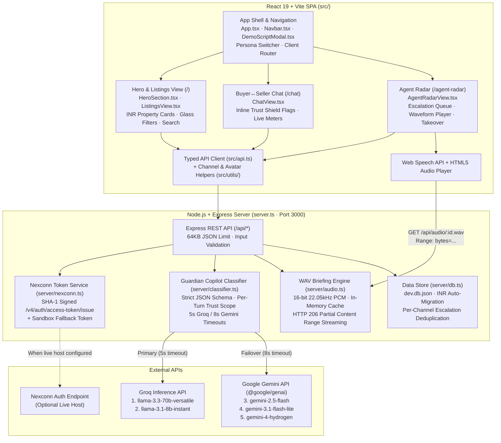
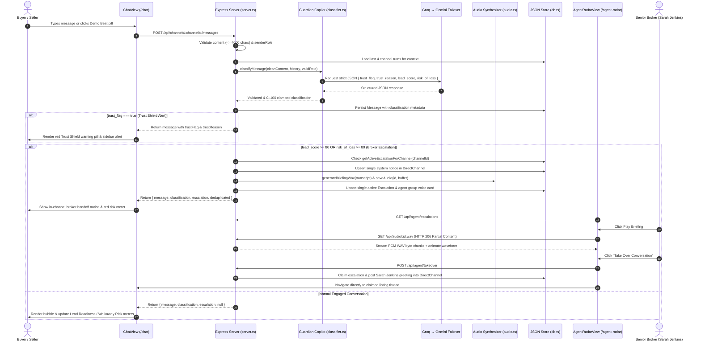

<div align="center">

# DealGuard

**Autonomous Guardian Copilot for Real-Estate Chat Deals**

*Every deal dies one of two ways — a scam, or a missed moment.*

[](./LICENSE)
[](https://www.typescriptlang.org/)
[](https://react.dev/)
[](https://nodejs.org/)
[](#)

</div>

---

## Overview

Peer-to-peer real-estate messaging marketplaces suffer from two costly failure modes:

1. **Advance-fee & off-platform scams** — Bad actors push buyers to transfer booking deposits via UPI, wire transfers, gift cards, or crypto before an in-person tour, or coerce them onto unmonitored messaging apps.
2. **Silent buyer drop-off & missed hot leads** — High-intent buyers ready to close or frustrated buyers about to walk away go unnoticed until the deal is already lost.

**DealGuard** is a full-stack real-estate chat marketplace built for the **Nexconn Build Challenge 2026**. It embeds **Guardian Copilot** — a server-side multi-model LLM safety and deal-intelligence layer — directly into every buyer↔seller channel to flag scams inline in real time and automatically escalate high-intent or walkaway threads (`>= 80%`) to a human senior broker with synthesized spoken audio briefings.

---

## Key Features

- 🛡️ **Trust Shield (Real-Time Scam Detection)** — Evaluates every message independently via a real multi-model LLM chain (zero hardcoded keyword bypasses) and attaches an immediate red warning badge with concise fraud reasoning when advance deposits, mailed-key stories, or off-platform coercion appear.
- 📡 **Hot-Lead & Walkaway Radar** — Continuously scores **Lead Readiness** (`0–100%`) and **Walkaway Risk** (`0–100%`) on every turn, rendering live telemetry meters in both desktop sidebar and mobile drawer views.
- 🔊 **Spoken Broker Audio Briefings (HTTP 206 Streaming)** — When either score crosses `80%`, DealGuard generates a broker briefing transcript, synthesizes a 16-bit 22.05 kHz PCM WAV stream served with full `Accept-Ranges: bytes` / `206 Partial Content` support, and pairs it with browser Web Speech playback and an animated waveform player.
- 🤝 **1-Click Broker Takeover & Escalation Deduplication** — Enforces a single active escalation and system notice per channel to prevent alert spam, while letting Senior Broker **Sarah Jenkins** claim and join the buyer↔seller conversation in one click.
- 💬 **Per-Listing Nexconn Channels & Persona Switcher** — Four verified INR architectural listings (`₹8.25 Cr` – `₹20.50 Cr`) backed by dedicated `DirectChannel` threads (`channel_alex_priya`, `channel_listing_2`, `channel_listing_3`, `channel_listing_4`), a broker `GroupChannel` (`channel_agent_group`), and instant switching across Buyer, 3 Sellers, and Senior Broker roles.
- 🎬 **Interactive Demo Guide & Reset** — Built-in 2-beat scripted demo launcher, unscripted adversarial prompt ideas, and 1-click database reset.

---

## Tech Stack

| Layer | Technologies |
| :--- | :--- |
| **Frontend** | React 19, TypeScript, Vite 8, Tailwind CSS v4, Motion (`motion/react`), Lucide React, Inter Tight & JetBrains Mono |
| **Messaging SDK** | `@nexconn/chatui`, `@nexconn/engine`, `@nexconn/chat` (with `lit` peer runtime) |
| **Backend** | Node.js 22+, Express 4, `tsx`, `dotenv` |
| **AI / LLM Pipeline** | Groq API (`llama-3.3-70b-versatile` → `llama-3.1-8b-instant`) with automatic failover to Google Gemini via `@google/genai` (`gemini-2.5-flash` → `gemini-3.1-flash-lite` → `gemini-4-hydrogen`) |
| **Audio & Persistence** | Custom 16-bit PCM WAV synthesizer + HTTP `206` byte-range streaming (`server/audio.ts`), JSON file persistence (`dev.db.json`) |
| **Testing & Security** | Vitest 5 (unit, API integration, adversarial real-LLM tests), custom PII & secret scanner (`scripts/scan-pii.ts`) |

---

## Architecture Diagram



---

## End-to-End Flow Diagram



---

## Project Structure

```text
dealguard/
├── .env.example                 # Template for optional Groq, Gemini, and Nexconn credentials
├── .gitignore                   # Ignores node_modules, dist, .env*, dev.db.json, logs, OS/IDE files
├── CONTRIBUTING.md              # Contribution workflow, coding conventions, and required checks
├── LICENSE                      # MIT License
├── README.md                    # Project overview, diagrams, setup, usage, and release docs
├── index.html                   # SPA entry HTML with Inter Tight / JetBrains Mono fonts & OG metadata
├── metadata.json                # Application name and capability metadata
├── package.json                 # Dependencies and scripts (dev, build, lint, test, seed:demo, scan:pii)
├── tsconfig.json                # TypeScript compiler configuration
├── vite.config.ts               # Vite 8 configuration with React and Tailwind v4 plugins
├── server.ts                    # Express REST API, HTTP 206 audio streaming, and Vite/static hosting
├── public/
│   └── favicon.ico              # Browser tab favicon
├── scripts/
│   └── scan-pii.ts              # Automated scanner for leaked API keys and non-synthetic phone numbers
├── server/
│   ├── audio.ts                 # 16-bit 22.05 kHz PCM WAV briefing generator and in-memory buffer store
│   ├── classifier.ts            # Real multi-model LLM classifier (Groq + Gemini failover with timeouts)
│   ├── db.ts                    # JSON store (dev.db.json), INR migration, and escalation deduplication
│   ├── nexconn.ts               # Nexconn token signing (SHA-1) and local sandbox token issuer
│   ├── seed.ts                  # CLI script (`npm run seed:demo`) to reset synthetic listings & chats
│   └── types.ts                 # Shared backend TypeScript interfaces
├── src/
│   ├── main.tsx                 # React 19 entry point
│   ├── index.css                # Tailwind v4 theme tokens, glass helpers, radar sweep & waveform CSS
│   ├── App.tsx                  # Client-side router (/, /chat, /agent-radar) and persona state manager
│   ├── api.ts                   # Typed fetch wrappers for all /api/* backend endpoints
│   ├── types.ts                 # Shared frontend TypeScript interfaces
│   ├── utils/
│   │   ├── avatars.ts           # Maps persona IDs/names to local portrait assets
│   │   └── channels.ts          # Maps listing IDs <-> Nexconn DirectChannel IDs
│   ├── assets/images/           # Local hero video/poster, 5 persona portraits, 4 property photos
│   └── components/
│       ├── Navbar.tsx           # Transparent-to-glass pill navbar, persona dropdown, mobile bottom bar
│       ├── HeroSection.tsx      # 100vh looping hero video, animated Copilot card, tech stack marquee
│       ├── ListingsView.tsx     # Glass filter pills, search input, INR property cards with hover zoom
│       ├── ChatView.tsx         # Buyer↔Seller chat, inline Trust Shield flags, Radar sidebar & drawer
│       ├── AgentRadarView.tsx   # Broker escalation queue, rotating radar empty state, waveform player
│       └── DemoScriptModal.tsx  # Interactive 2-beat demo runner and unscripted test prompt guide
└── tests/
    ├── unit/
    │   ├── classifier.test.ts           # Verifies zero keyword bypasses, JSON parsing & graceful fallback
    │   ├── data-store.test.ts           # Verifies deduplication, per-listing seeding & reset behavior
    │   ├── nexconn-signing.test.ts      # Verifies token format and persona isolation
    │   ├── routes-and-channels.test.ts  # Verifies listing <-> channel ID mapping
    │   └── thresholds.test.ts           # Verifies 80% escalation threshold boundaries
    ├── integration/
    │   └── api.test.ts                  # End-to-end API, adversarial unscripted LLM & HTTP 206 tests
    └── security/
        └── scan-pii.test.ts             # Runs scripts/scan-pii.ts as an automated Vitest security gate
```

---

## Installation & Setup

### Prerequisites

- **Node.js** `22.0.0` or higher
- **npm** `10.0.0` or higher
- *(Optional, recommended for live AI classification)* A free API key from [Groq Console](https://console.groq.com) and/or [Google AI Studio](https://aistudio.google.com)

### 1. Clone the repository

```bash
git clone https://github.com/<your-username>/dealguard.git
cd dealguard
```

### 2. Install dependencies

```bash
npm install
```

### 3. Configure environment variables

```bash
cp .env.example .env
```

Edit `.env` with your keys:

```env
PORT=3000
GROQ_API_KEY="your_groq_api_key"
GEMINI_API_KEY="your_gemini_api_key"

# Optional — leave blank to run in local Nexconn sandbox token mode
NEXCONN_APP_KEY=""
NEXCONN_APP_SECRET=""
NEXCONN_API_HOST="https://api.us-east-1.nexconn.ai"
```

> **Note:** If neither `GROQ_API_KEY` nor `GEMINI_API_KEY` is configured, the app still starts and runs cleanly; Guardian Copilot degrades safely to neutral scores (`lead_score: 50`, `risk_of_loss: 20`, `trust_flag: false`) rather than crashing.

### 4. Seed demo data & start the server

```bash
npm run seed:demo
npm run dev
```

Open **http://localhost:3000** in your browser.

### 5. Run verification checks

```bash
# TypeScript type-check
npm run lint

# Security scan (secrets & non-synthetic phone numbers)
npm run scan:pii

# Full unit, integration, and security suite (keep `npm run dev` running in another terminal for integration tests)
npm test

# Production build & start
npm run build
NODE_ENV=production npm start
```

---

## Usage Guide & API Examples

### Interactive UI Walkthrough

1. **Explore Listings (`/`)** — Filter verified INR properties (`All`, `Condominium`, `Penthouse`, `Villa`, `Loft`), search by neighborhood or amenity, and click any card to open its dedicated encrypted channel.
2. **Test Trust Shield (`/chat`)** — Click **Beat 1: Scam Alert** or type any unscripted advance-fee message (e.g., *"Wire ₹2,00,000 to my personal account today before I share the gate code"*). Guardian Copilot flags the bubble in `#E5484D` red with a specific reason.
3. **Test Hot-Lead / Walkaway Escalation (`/chat` → `/agent-radar`)** — Click **Beat 2: Walkaway Risk** or type *"Forget it, this is taking too long, I'll look elsewhere."* Walkaway Risk jumps past `80%`, posting a broker handoff notice and queuing a spoken briefing in **Agent Radar**.
4. **Play Briefing & Take Over (`/agent-radar`)** — Switch persona to **Agent (Sarah Jenkins)** or click **Agent Radar**, click **Play Briefing** to stream the WAV briefing with live animated waveform bars, then click **Take Over Conversation** to join the thread.

### Sample API Inputs & Outputs

#### Classify a Message (`POST /api/copilot/classify`)

```bash
curl -X POST http://localhost:3000/api/copilot/classify \
  -H "Content-Type: application/json" \
  -d '{
    "message": "Wire ₹2,50,000 to my personal account before our walkthrough to hold the flat",
    "senderRole": "seller"
  }'
```

**Sample Response:**

```json
{
  "trust_flag": true,
  "trust_reason": "Demand for upfront bank wire deposit before an in-person viewing.",
  "lead_score": 12,
  "risk_of_loss": 22
}
```

#### Send a Channel Message & Trigger Escalation (`POST /api/channels/channel_alex_priya/messages`)

```bash
curl -X POST http://localhost:3000/api/channels/channel_alex_priya/messages \
  -H "Content-Type: application/json" \
  -d '{
    "senderId": "buyer_alex",
    "senderName": "Alex Chen",
    "senderRole": "buyer",
    "listingId": "listing_1",
    "content": "ok nvm I will look elsewhere"
  }'
```

**Sample Response (abbreviated):**

```json
{
  "message": {
    "id": "msg_1763630700000_x9k2a",
    "channelId": "channel_alex_priya",
    "senderName": "Alex Chen",
    "content": "ok nvm I will look elsewhere",
    "trustFlag": false,
    "leadScore": 15,
    "riskOfLoss": 92
  },
  "classification": {
    "trust_flag": false,
    "trust_reason": null,
    "lead_score": 15,
    "risk_of_loss": 92
  },
  "escalation": {
    "id": "esc_1763630700000",
    "listingTitle": "The Horizon Marina Residence",
    "triggerReason": "risk_of_loss",
    "riskOfLoss": 92,
    "audioUrl": "/api/audio/esc_1763630700000.wav?v=1763630700000",
    "status": "active"
  },
  "deduplicated": false
}
```

---

## Screenshots & Demo

> Replace the placeholders below with captures from your running deployment before publishing your release.

| View | Preview |
| :--- | :--- |
| **Hero & Verified INR Listings (`/`)** | `` |
| **Buyer↔Seller Chat with Trust Shield (`/chat`)** | `` |
| **Agent Radar & Spoken Briefing Player (`/agent-radar`)** | `` |

---

## Roadmap & Known Issues

### Planned Improvements

- [ ] Replace local `dev.db.json` storage with PostgreSQL or Firestore for multi-instance production deployments.
- [ ] Replace client-side persona switching with full authenticated sessions (JWT / OAuth) and role-based access control.
- [ ] Upgrade synthesized PCM briefing audio to neural TTS (e.g., Gemini TTS / ElevenLabs) with persistent object storage.
- [ ] Add live WebSocket push updates to **Agent Radar** and **Chat** instead of polling on view transitions.

### Known Issues

- **In-memory audio cache**: Synthesized WAV buffers live in memory (`server/audio.ts`) and are lazily regenerated on demand from the escalation transcript if the server restarts.
- **Nexconn sandbox fallback**: When `NEXCONN_API_HOST` points to the default `api.us-east-1.nexconn.ai` host in offline/sandboxed networks or when Nexconn credentials are omitted, `/api/nexconn/token` issues a deterministic local sandbox token (`nc_*`) so the demo remains fully functional without external network failures.
- **Integration tests require a running server + LLM key**: Running `npm test` executes live adversarial tests in `tests/integration/api.test.ts` against `http://localhost:3000` and expects either `GROQ_API_KEY` or `GEMINI_API_KEY` to be configured on the running server.

---

## Contributing

Contributions are welcome! Please read [CONTRIBUTING.md](./CONTRIBUTING.md) for development setup, coding conventions, and required quality checks before submitting a pull request.

---

## License

This project is licensed under the **MIT License** — see the [LICENSE](./LICENSE) file for details.

---

## Author & Contact

- **Built by:** DealGuard / Dhaya (`dhayad1310@gmail.com`)
- **Event:** Nexconn Build Challenge 2026
- **Issues & Feedback:** Open an issue in this GitHub repository.
