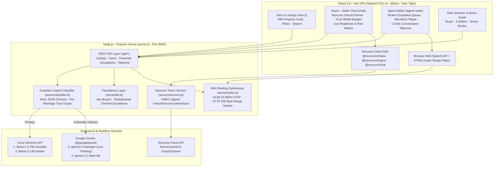
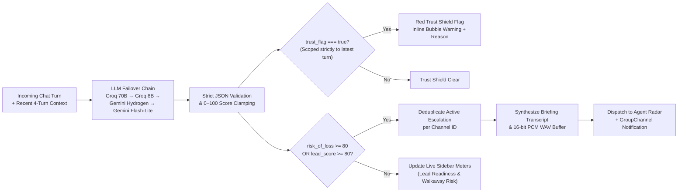

# DealGuard — Autonomous Guardian Copilot for Real-Estate Deals

> **"Every deal dies one of two ways — a scam, or a missed moment."**

**DealGuard** is a full-stack real-estate chat marketplace built for the **Nexconn Build Challenge 2026**. It embeds **Guardian Copilot** — a real-time multi-model AI safety and deal-intelligence layer — inside buyer↔seller channels to catch advance-fee scams before funds move and escalate high-intent or walkaway leads to human brokers with spoken audio briefings.

---

## System Architecture



---

## End-to-End Message & Escalation Flow

```mermaid
sequenceDiagram
    autonumber
    actor Participant as Buyer / Seller
    participant ChatUI as Chat UI (/chat)
    participant Express as Express API (server.ts)
    participant Copilot as Guardian Copilot (classifier.ts)
    participant LLM as Groq / Gemini LLM Chain
    participant Audio as Audio Synthesizer (audio.ts)
    participant DB as Store (db.ts)
    participant Radar as Agent Radar (/agent-radar)
    actor Broker as Senior Broker (Sarah Jenkins)

    Participant->>ChatUI: Sends message in listing DirectChannel
    ChatUI->>Express: POST /api/channels/:channelId/messages
    Express->>Copilot: classifyMessage(content, last 4 turns, senderRole)
    Copilot->>LLM: Structured JSON prompt (per-message trust_flag scope)
    LLM-->>Copilot: { trust_flag, trust_reason, lead_score, risk_of_loss }
    Copilot-->>Express: Validated & clamped classification
    Express->>DB: Save message with classification metadata

    alt Trust Shield Flag (trust_flag === true)
        Express-->>ChatUI: Return flagged message + trust_reason
        ChatUI->>Participant: Render red Trust Shield warning pill & sidebar alert
    end

    alt Hot-Lead or Walkaway Threshold (lead_score >= 80 OR risk_of_loss >= 80)
        Express->>DB: Upsert single active Escalation for channelId
        Express->>DB: Upsert system notice in DirectChannel
        Express->>Audio: generateBriefingWav(transcript) & cache buffer
        Express->>DB: Upsert voice briefing card in channel_agent_group
        Express-->>ChatUI: Return message + escalation payload
        ChatUI->>Participant: Show broker-handoff system banner & updated meters
        Radar->>Express: Poll GET /api/agent/escalations
        Broker->>Radar: Click Play Briefing
        Radar->>Express: GET /api/audio/:id.wav (HTTP 206 Partial Content)
        Broker->>Radar: Click "Take Over Conversation"
        Radar->>Express: POST /api/agent/takeover
        Express->>DB: Claim escalation & post Sarah Jenkins greeting to channel
    else Standard Engaged Turn
        Express-->>ChatUI: Return message + updated readiness/risk scores
    end
```

---

## Guardian Copilot Decision Pipeline



---

## Core Capabilities

1. **Trust Shield (Real-Time Scam Detection)**
   - Evaluates every buyer↔seller message independently (preventing prior scam flags from bleeding onto subsequent clean messages) for advance booking/holding deposits, unverified UPI/wire/crypto transfers, mailed-key stories, and off-platform coercion.
   - Attaches a high-contrast `#E5484D` Trust Shield alert badge with concise fraud reasoning directly to flagged bubbles and updates the Guardian Copilot sidebar.
2. **Hot-Lead Radar & Spoken Broker Briefings**
   - Continuously scores **Lead Readiness** (`lead_score`) and **Walkaway Risk** (`risk_of_loss`) on a 0–100 scale.
   - Crossing the `80%` threshold automatically creates or updates a single deduplicated escalation per channel, posts an in-channel broker handoff notice, synthesizes a spoken WAV briefing (`GET /api/audio/:id.wav` with full HTTP `206 Partial Content` byte-range streaming), and queues the thread in **Agent Radar** (`/agent-radar`) for 1-click **Take Over Conversation**.
3. **Nexconn Multi-Channel Marketplace & Role Switcher**
   - 4 verified INR architectural listings (`₹8.25 Cr` – `₹20.50 Cr`), each backed by its own `DirectChannel` (`channel_alex_priya`, `channel_listing_2`, `channel_listing_3`, `channel_listing_4`) plus a priority `GroupChannel` (`channel_agent_group`) for broker escalations.
   - Instant persona switching between Buyer (`Alex Chen`), Listing Sellers (`Priya Patel`, `Elena Rostova`, `Marcus Vance`), and Senior Broker (`Sarah Jenkins`).

---

## API Surface

| Method | Endpoint | Purpose |
| :--- | :--- | :--- |
| `POST` | `/api/nexconn/token` | Signs & issues Nexconn user access tokens (`/v4/auth/access-token/issue`) with sandbox fallback |
| `GET` | `/api/listings`, `/api/listings/:id` | Returns verified property listings (INR pricing) |
| `GET` | `/api/users` | Returns Buyer, Seller, and Senior Broker personas |
| `GET` | `/api/channels/:channelId/messages` | Fetches persisted channel conversation history |
| `POST` | `/api/channels/:channelId/messages` | Persists turn, runs Guardian Copilot LLM classifier, and triggers deduplicated escalations |
| `POST` | `/api/copilot/classify` | Direct Guardian Copilot JSON classification endpoint |
| `POST` | `/api/copilot/escalate` | Manual broker escalation trigger (deduplicated per channel) |
| `GET` | `/api/agent/escalations` | Returns active and claimed broker escalation briefings |
| `POST` | `/api/agent/takeover` | Claims an escalation and injects Senior Broker response into the channel |
| `GET` | `/api/audio/:id.wav` | Streams synthesized WAV briefing with `Accept-Ranges: bytes` and HTTP `206` support |
| `POST` | `/api/seed/reset` | Resets listings, threads, and escalations to the clean demo state |

---

## Project Structure

```text
.
├── server.ts                  # Express API + Vite dev middleware / production static host
├── server/
│   ├── classifier.ts          # Multi-model LLM classifier (Groq + Google Gemini failover)
│   ├── nexconn.ts             # Nexconn token signing & channel integration
│   ├── audio.ts               # 16-bit PCM WAV briefing synthesizer & in-memory cache
│   ├── db.ts                  # JSON store (dev.db.json), INR migrations & deduplication
│   ├── seed.ts                # Demo seed & reset CLI script
│   └── types.ts               # Shared backend data contracts
├── src/
│   ├── App.tsx                # SPA router (/, /chat, /agent-radar) & persona state
│   ├── api.ts                 # Typed frontend API client
│   ├── utils/avatars.ts       # Persona portrait mapping
│   └── components/
│       ├── Navbar.tsx         # Glass pill navigation, role dropdown & mobile tab bar
│       ├── HeroSection.tsx    # Full-bleed video hero & live animated Copilot preview
│       ├── ListingsView.tsx   # INR property cards, glass filter pills & search
│       ├── ChatView.tsx       # Buyer↔Seller chat, Trust Shield alerts & Radar sidebar
│       ├── AgentRadarView.tsx # Escalation queue, radar empty state & waveform player
│       └── DemoScriptModal.tsx# Interactive 2-beat demo guide & unscripted prompt ideas
└── tests/                     # Unit, API integration, and PII/secret scan tests
```

---

## Environment Configuration

Copy `.env.example` to `.env` and populate your credentials:

```env
# Nexconn Chat SDK credentials (from https://console.nexconn.ai)
NEXCONN_APP_KEY=your_nexconn_app_key
NEXCONN_APP_SECRET=your_nexconn_app_secret
NEXCONN_API_HOST=https://api.us-east-1.nexconn.ai

# Guardian Copilot LLM Providers (automatic Groq -> Gemini failover)
GROQ_API_KEY=your_groq_api_key
GEMINI_API_KEY=your_gemini_api_key
```

---

## Scripted Demo Beats

1. **Beat 1 — Trust Shield Scam Detection**
   - Send: `"Please transfer the booking amount to this UPI ID before I show you the flat"`
   - Result: Instant red **Trust Shield Warning** pill on the message bubble with fraud reasoning (also catches unscripted wire, Zelle, crypto, or mailed-key scams in any phrasing).
2. **Beat 2 — Hot-Lead Radar & Spoken Audio Briefing**
   - Send: `"ok nvm I'll look elsewhere"`
   - Result: Walkaway risk crosses `80%`, triggering an in-channel broker handoff banner and a spoken audio briefing card in **Agent Radar** (`/agent-radar`) with 1-click **Take Over Conversation**.

---

## Development, Build & Tests

```bash
# Install dependencies
npm install

# Reset demo data to default INR seed state
npm run seed:demo

# Start full-stack dev server (Express + Vite on Port 3000)
npm run dev

# Type-check with TypeScript
npm run lint

# Run unit, integration, and security tests
npm test

# Build production client bundle
npm run build
```

All property listings, addresses, and user profiles in this repository are synthetic.
